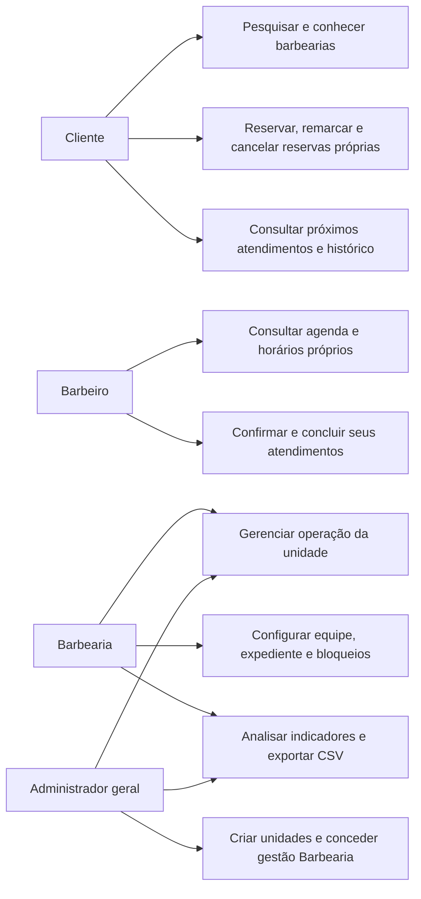
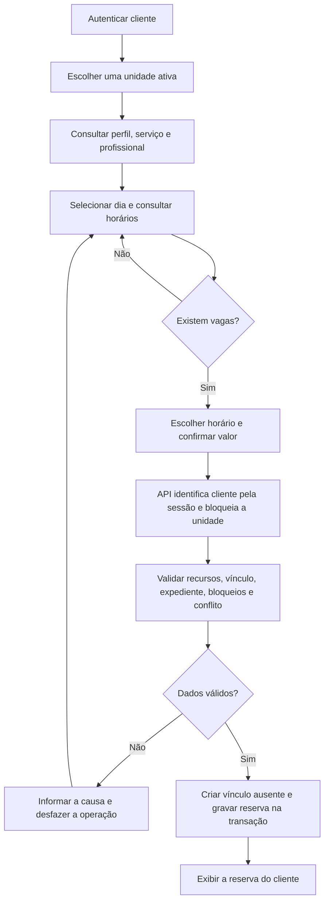
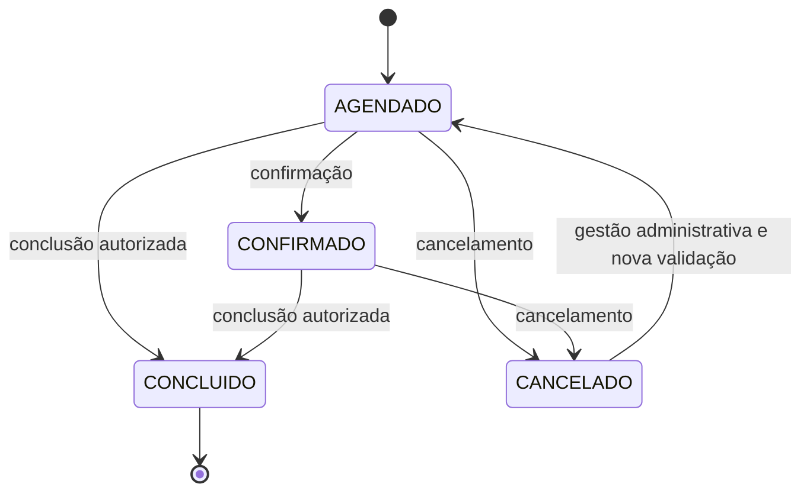

# 09. Modelagem de dados

## 9.1. Entidades e decisões

O núcleo possui oito entidades de negócio: barbearia, cliente, vínculo cliente–barbearia, barbeiro, serviço, plano, assinatura e agendamento. A evolução acrescentou quatro tabelas de suporte: usuário, permissão, expediente e bloqueio.

O cliente é compartilhado entre unidades; o vínculo possui situação própria por estabelecimento. O acesso de uma pessoa ao sistema é separado do seu cadastro de cliente. Uma conta pode ser cliente, possuir permissões profissionais/locais e, quando explicitamente habilitada, administração global.

Cada atendimento conserva início, término e valor combinado. O preço do catálogo representa a oferta atual; não substitui os valores anteriores. Expediente representa disponibilidade semanal recorrente; bloqueio representa indisponibilidade em um intervalo específico.

Os relacionamentos e campos completos estão no [DER](10.-der.md) e no [modelo lógico](11.-modelo-logico.md).

## 9.2. Casos de uso atuais

## 9.3. Fluxo da reserva pelo cliente

A criação do vínculo e da reserva é atômica. Caso haja impedimento, não fica um vínculo parcial originado pela tentativa. O mesmo intervalo pode ser mostrado a dois clientes, mas o servidor volta a validá-lo dentro da transação ao salvar.

## 9.4. Estados do atendimento

O diagrama representa o fluxo usual. A gestão pode registrar atendimentos históricos e outras alterações permitidas pelo serviço. O cliente cria em AGENDADO e só altera suas reservas futuras em aberto. O barbeiro pode confirmar e concluir as suas; conclusão pelo barbeiro exige que o início já tenha ocorrido. CONCLUIDO é definitivo.

## 9.5. Responsabilidades das classes

| Componente | Responsabilidade implementada |
| --- | --- |
| `Barbearia`, `Cliente`, `Vinculo`, `Barbeiro`, `Servico`, `Plano`, `Assinatura`, `Agendamento` | Entidades JPA e estado persistido do domínio |
| `GestaoService` | Compatibilidade, gravação transacional, valores e cálculo de disponibilidade |
| `HorariosService` | Expedientes, bloqueios e suas validações |
| `Acesso` e `ControllerGuard` | Identidade, autorização e isolamento dos recursos |
| Controllers | Contratos HTTP, validação de entrada e encaminhamento |
| Repositories e `JdbcTemplate` | Persistência e consultas parametrizadas |

`usuario`, `permissao`, `expediente` e `bloqueio` são acessados principalmente por JDBC; não é correto supor uma entidade JPA para cada tabela técnica.

## 9.6. Diagramas da fase inicial

Os anexos abaixo registram a modelagem anterior. Os fluxos e responsabilidades atuais são os descritos acima; os anexos não incluem todas as extensões de acesso e agenda.

- [Casos de uso original](<.gitbook/assets/BarberFlow_diagramas (3)-Casos de uso.jpg>)
- [Fluxo de agendamento original](<.gitbook/assets/BarberFlow_diagramas (3)-Fluxo de agendamento.jpg>)
- [Estados do agendamento original](<.gitbook/assets/BarberFlow_diagramas (3)-Estados do agendamento.jpg>)
- [Diagrama de classes original](<.gitbook/assets/BarberFlow_diagramas (3)-Diagrama de classes.jpg>)
- [Representação anterior dos estados](.gitbook/assets/image.png)
