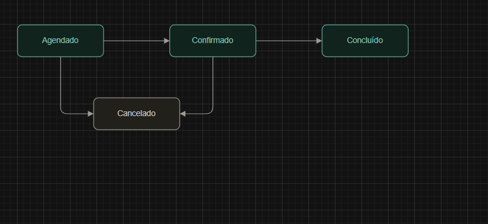

# 09. Modelagem de dados

## **9.1 Levantamento dos dados**

O levantamento de dados foi realizado a partir das principais operações previstas para o BarberFlow. Foram identificadas as informações necessárias para o gerenciamento das barbearias, clientes, profissionais, serviços, agendamentos, planos e assinaturas.

A partir desse levantamento, foram definidas as entidades e seus respectivos atributos, considerando as regras de negócio e os relacionamentos necessários para o funcionamento do sistema.

#### Entidades identificadas

<table data-header-hidden data-search="false"><thead><tr><th></th><th></th></tr></thead><tbody><tr><td>Entidade</td><td>Finalidade</td></tr><tr><td><strong>Barbearia</strong></td><td>Representar os estabelecimentos cadastrados no sistema.</td></tr><tr><td><strong>Cliente</strong></td><td>Armazenar os dados dos clientes.</td></tr><tr><td><strong>Cliente_Barbearia</strong></td><td>Representar o vínculo entre clientes e barbearias.</td></tr><tr><td><strong>Barbeiro</strong></td><td>Armazenar os profissionais vinculados às barbearias.</td></tr><tr><td><strong>Serviço</strong></td><td>Representar os serviços oferecidos pelas barbearias.</td></tr><tr><td><strong>Agendamento</strong></td><td>Registrar os atendimentos agendados.</td></tr><tr><td><strong>Plano</strong></td><td>Representar os planos oferecidos pelas barbearias.</td></tr><tr><td><strong>Assinatura</strong></td><td>Registrar a adesão de clientes aos planos.</td></tr></tbody></table>

***

## 9.2 Relacionamentos e cardinalidades

Os relacionamentos foram definidos considerando as regras de negócio e a forma como as informações serão utilizadas pelo sistema.

Os principais relacionamentos identificados são:

* **Barbearia 1:N Barbeiro**
* **Barbearia 1:N Serviço**
* **Barbearia 1:N Plano**
* **Barbearia 1:N Agendamento**
* **Cliente 1:N Agendamento**
* **Barbeiro 1:N Agendamento**
* **Serviço 1:N Agendamento**
* **Cliente 1:N Assinatura**
* **Plano 1:N Assinatura**
* **Cliente N:N Barbearia**, resolvido pela entidade associativa **Cliente\_Barbearia**.

#### Relacionamento Cliente × Barbearia

O relacionamento entre Cliente e Barbearia é N:N, pois um mesmo cliente poderá utilizar serviços de diferentes barbearias, enquanto uma barbearia poderá possuir diversos clientes.

Para representar esse relacionamento no modelo relacional, foi criada a entidade associativa **Cliente\_Barbearia**, que armazena as chaves dos dois registros e informações sobre o vínculo.

***

## 9.3 Decisões de modelagem

### Cliente\_Barbearia

A entidade **Cliente\_Barbearia** foi criada para representar o relacionamento N:N entre clientes e barbearias.

Essa decisão permite que o mesmo cliente seja vinculado a diferentes barbearias sem a necessidade de duplicar seu cadastro.

Também foi definida uma restrição de unicidade sobre `cliente_id` e `barbearia_id`, evitando que o mesmo cliente seja cadastrado duas vezes na mesma barbearia.

***

### Agendamento

A entidade **Agendamento** concentra as informações necessárias para registrar um atendimento, relacionando a barbearia, o cliente, o barbeiro e o serviço.

Essa estrutura permite consultar quem será atendido, qual profissional realizará o atendimento, qual serviço será realizado e em qual barbearia ocorrerá o atendimento.

***

### Controle de disponibilidade

A disponibilidade do barbeiro é determinada a partir dos agendamentos existentes para o profissional no intervalo solicitado.

Antes de registrar um novo agendamento, o sistema deverá verificar se existe conflito de horário.

***

### Chaves e integridade

As entidades possuem chaves primárias para identificar seus registros. As chaves estrangeiras são utilizadas para representar os relacionamentos entre as entidades e manter a integridade referencial dos dados.

***

### Restrições

Algumas regras de negócio foram representadas por restrições no modelo, como campos obrigatórios, valores mínimos e unicidade de determinados dados.

Exemplos incluem a obrigatoriedade dos dados principais, a unicidade do vínculo entre cliente e barbearia e a validação de valores como preço e duração dos serviços.

***

## 9.4 Casos de uso

O diagrama de casos de uso apresenta as principais interações dos usuários com o sistema BarberFlow.

<figure><figcaption></figcaption></figure>

#### Principais atores

**Gestor**

* Gerenciar clientes;
* Gerenciar barbeiros;
* Gerenciar serviços;
* Gerenciar planos;
* Controlar assinaturas;
* Consultar informações.

**Cliente**

* Realizar agendamento;
* Consultar informações.

**Barbeiro**

* Consultar agenda.

***

## 9.5 Fluxo do processo de agendamento

O fluxo abaixo representa o processo de realização de um agendamento, demonstrando como o sistema verifica os vínculos necessários e a disponibilidade do barbeiro antes de registrar o atendimento.

<figure><figcaption></figcaption></figure>

O fluxo demonstra a integração entre as regras de negócio, a aplicação e o banco de dados. O sistema verifica o vínculo do cliente com a barbearia, verifica a disponibilidade do barbeiro e, caso todas as condições sejam atendidas, registra o agendamento.

***

## 9.6 Estados do agendamento

O agendamento possui estados que representam sua evolução durante o processo de atendimento.

<figure><figcaption></figcaption></figure>

* **Agendado:** atendimento criado no sistema.
* **Confirmado:** atendimento confirmado.
* **Concluído:** atendimento realizado.
* **Cancelado:** atendimento cancelado antes da conclusão.

Um agendamento pode evoluir de **Agendado → Confirmado → Concluído** ou ser direcionado para **Cancelado**, conforme a situação do atendimento.

### 9.7 Diagrama de Classes

#### Introdução

O diagrama de classes representa a estrutura das principais classes que compõem o sistema BarberFlow, seus atributos, comportamentos e relacionamentos.

A modelagem busca aproximar a estrutura do sistema desenvolvido da estrutura definida no banco de dados, permitindo visualizar como as entidades serão representadas na aplicação.

#### Classes representadas

O diagrama possui as seguintes classes:

* **Cliente**
* **ClienteBarbearia**
* **Barbearia**
* **Barbeiro**
* **Serviço**
* **Agendamento**
* **Plano**
* **Assinatura**

Essas classes correspondem às principais entidades definidas na modelagem de dados.

#### Principais comportamentos

Além dos atributos, algumas classes possuem comportamentos relacionados às regras do sistema:

* **ClienteBarbearia:** permite verificar e alterar o status do vínculo;
* **Barbearia:** permite ativar ou desativar a barbearia;
* **Agendamento:** permite confirmar, concluir, cancelar e verificar conflitos de horário;
* **Barbeiro:** permite verificar sua disponibilidade em determinado intervalo;
* **Serviço:** permite calcular o horário de término a partir da duração do serviço;
* **Plano:** permite verificar se o plano está ativo;
* **Assinatura:** permite verificar se a assinatura está vigente.

#### Relacionamento com o modelo de dados

O diagrama de classes mantém correspondência com as entidades apresentadas no modelo lógico, mas acrescenta os comportamentos que serão implementados pela aplicação. Dessa forma, enquanto o modelo lógico representa principalmente a estrutura dos dados, o diagrama de classes representa também responsabilidades e comportamentos das classes.

#### Diagrama

<figure><figcaption></figcaption></figure>
