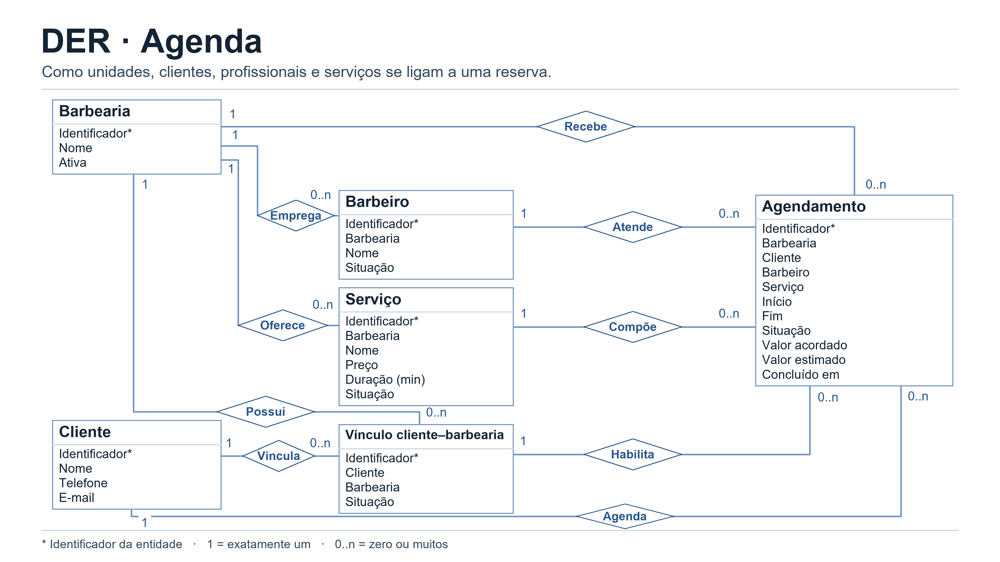
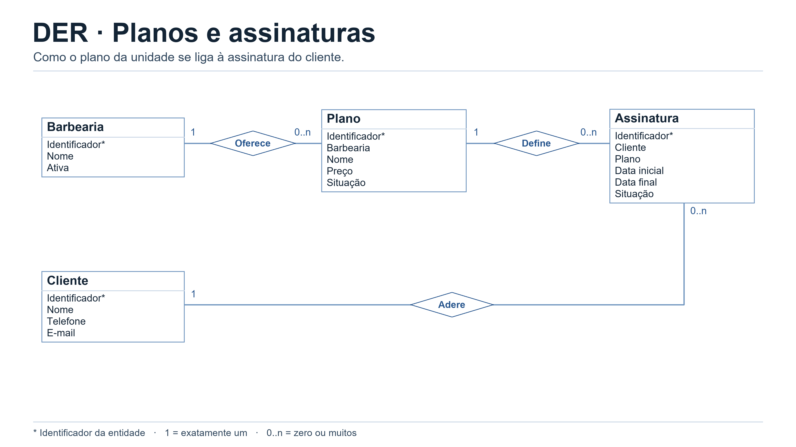
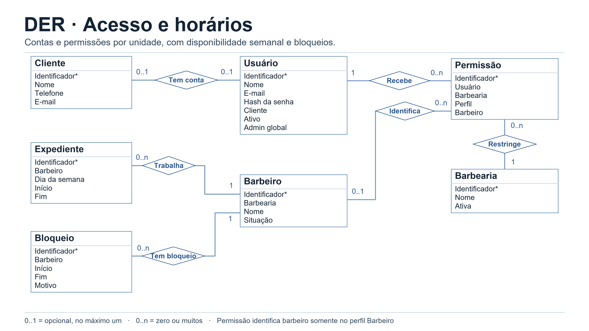

# 10. DER

## 10.1. Modelo relacional atual

O diagrama inclui as oito tabelas de negócio e as quatro tabelas técnicas de acesso e disponibilidade. `flyway_schema_history` é metadado de migração, não entidade do domínio.

### Agenda

### Planos e assinaturas

### Acesso e horários

O relacionamento `CLIENTE_BARBEARIA → AGENDAMENTO` usa a FK composta `(cliente_id, barbearia_id)`, referenciando o par único do vínculo. O diagrama não representa todas as restrições compostas: consulte o [modelo lógico](11.-modelo-logico.md).

A FK de `permissao.barbeiro_id` é opcional e só é preenchida para BARBEIRO. A associação cliente–usuário também é opcional dos dois lados, com no máximo uma conta por cliente. Permissões de acesso não devem ser confundidas com vínculo comercial do cliente.

## 10.2. Histórico

- [DER original corrigido](<.gitbook/assets/Diagrama ER com relacionamentos Oferece corrigidos.png>)
- [Modelo conceitual da fase inicial](<.gitbook/assets/BarberFlow_diagramas (3)-Modelo conceitual (ER).jpg>)

Esses arquivos preservam a fase de oito entidades; o diagrama atual acima documenta também as extensões implementadas.
