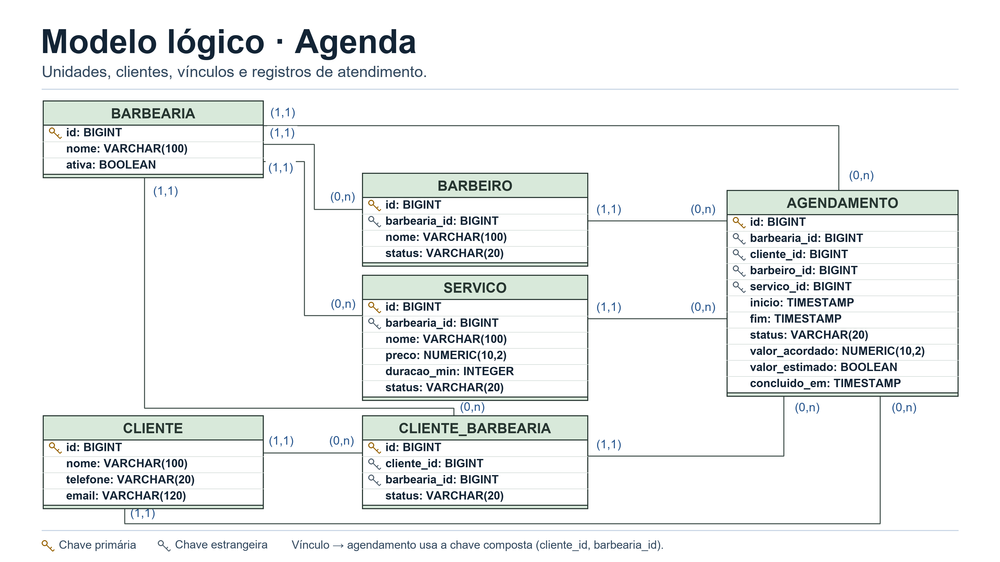
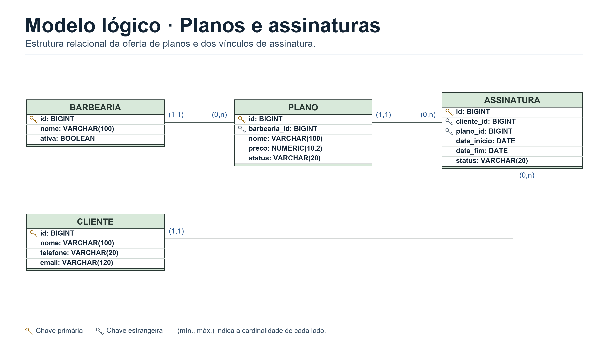
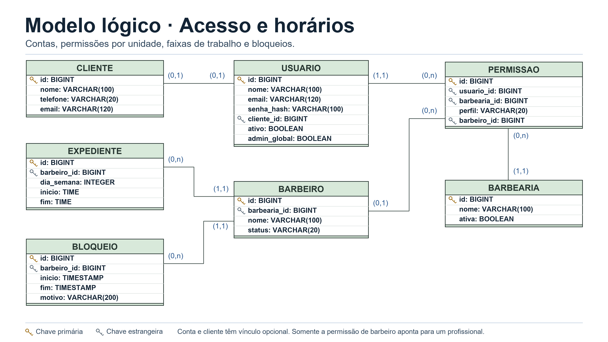

# 11. Modelo lógico

## Diagrama do modelo lógico

### Agenda

### Planos e assinaturas

### Acesso e horários

## 11.1. Dicionário das tabelas

Todos os identificadores primários usam `BIGINT GENERATED BY DEFAULT AS IDENTITY`. Os campos listados como opcionais aceitam NULL; os demais campos abaixo são obrigatórios no DDL. Os scripts de migração são a referência executável dos tipos e restrições.

| Tabela | Campos além do `id` |
| --- | --- |
| `barbearia` | `nome VARCHAR(100)`, `ativa BOOLEAN` |
| `cliente` | `nome VARCHAR(100)`, `telefone VARCHAR(20)` opcional, `email VARCHAR(120)` opcional e único |
| `cliente_barbearia` | `cliente_id BIGINT`, `barbearia_id BIGINT`, `status VARCHAR(20)` |
| `barbeiro` | `barbearia_id BIGINT`, `nome VARCHAR(100)`, `status VARCHAR(20)` |
| `servico` | `barbearia_id BIGINT`, `nome VARCHAR(100)`, `preco NUMERIC(10,2)`, `duracao_min INTEGER`, `status VARCHAR(20)` |
| `plano` | `barbearia_id BIGINT`, `nome VARCHAR(100)`, `preco NUMERIC(10,2)`, `status VARCHAR(20)` |
| `agendamento` | `barbearia_id BIGINT`, `cliente_id BIGINT`, `barbeiro_id BIGINT`, `servico_id BIGINT`, `inicio TIMESTAMP`, `fim TIMESTAMP`, `status VARCHAR(20)`, `valor_acordado NUMERIC(10,2)` opcional, `valor_estimado BOOLEAN`, `concluido_em TIMESTAMP` opcional |
| `assinatura` | `cliente_id BIGINT`, `plano_id BIGINT`, `data_inicio DATE`, `data_fim DATE` opcional, `status VARCHAR(20)` |
| `usuario` | `nome VARCHAR(100)`, `email VARCHAR(120)` único, `senha_hash VARCHAR(100)`, `cliente_id BIGINT` opcional e único, `ativo BOOLEAN`, `admin_global BOOLEAN` |
| `permissao` | `usuario_id BIGINT`, `barbearia_id BIGINT`, `perfil VARCHAR(20)`, `barbeiro_id BIGINT` opcional |
| `expediente` | `barbeiro_id BIGINT`, `dia_semana INTEGER`, `inicio TIME`, `fim TIME` |
| `bloqueio` | `barbeiro_id BIGINT`, `inicio TIMESTAMP`, `fim TIMESTAMP`, `motivo VARCHAR(200)` |

`valor_estimado` tem padrão TRUE; `usuario.ativo`, TRUE; `usuario.admin_global`, FALSE. O valor combinado é opcional no DDL por evolução do modelo, mas as novas reservas criadas pela aplicação registram o preço. Valores e datas migrados podem representar estimativas.

## 11.2. Chaves, unicidade e domínios

- `cliente_barbearia`: único `(cliente_id, barbearia_id)`; FKs para cliente e barbearia.
- `agendamento`: FKs individuais e FK composta para o vínculo; `fim > inicio`; status em AGENDADO, CONFIRMADO, CONCLUIDO e CANCELADO; valor não negativo quando informado.
- `barbeiro`, `servico`, `plano` e vínculo: status ATIVO ou INATIVO.
- `servico`: preço não negativo e duração positiva. `plano`: preço não negativo.
- `assinatura`: FKs para cliente e plano; fim ausente ou maior/igual ao início; status ATIVA, ENCERRADA ou CANCELADA.
- `usuario`: e-mail único e associação única opcional com cliente; armazena hash BCrypt, nunca a senha em texto.
- `permissao`: único `(usuario_id, barbearia_id, perfil)`; perfis BARBEARIA/BARBEIRO e ADMIN legado. BARBEIRO exige profissional; os perfis administrativos não o informam.
- `expediente`: dia entre 1 e 7, `fim > inicio`, único `(barbeiro_id, dia_semana, inicio)`.
- `bloqueio`: FK para profissional e `fim > inicio`.

O campo global de usuário é a autoridade de administrador da plataforma. A compatibilidade entre profissional e unidade da permissão, assim como várias condições comerciais, é complementada pela API; não decorre apenas das FKs individuais.

## 11.3. Índices e horários

Além dos índices de PK/UNIQUE, V3 cria índices de permissões por usuário/unidade e de intervalos da agenda/bloqueios por profissional. A aplicação usa horário local sem offset, persistido em TIMESTAMP sem fuso. O serviço hospedado foi configurado para `America/Sao_Paulo`; não há conversão automática entre fusos de unidades distintas.

## 11.4. Referência histórica

[Modelo lógico original de oito entidades](<.gitbook/assets/BarberFlow_diagramas (3)-Modelo lógico.jpg>). O dicionário acima corresponde à estrutura ampliada.
