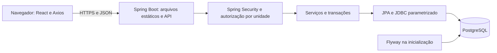

# 14. Desenvolvimento do sistema

## 14.1. Arquitetura implementada



No Render, o frontend compilado é servido pelo mesmo processo da API. No desenvolvimento com Vite, `/api` é encaminhado ao backend por proxy. O navegador nunca se conecta diretamente ao PostgreSQL.

## 14.2. Tecnologias da versão de referência

| Camada | Tecnologias |
| --- | --- |
| Backend | Java 21, Spring Boot 3.5.16, Spring Security, Bean Validation, Spring Data JPA/Hibernate e JdbcTemplate |
| Banco | PostgreSQL 18 e Flyway 11.20.3 |
| Interface | React 19.3.1, Vite 7.3.8 e Axios 1.21.1 |
| Build e entrega | Maven Wrapper, Node 24 na imagem Docker, GitHub e Render |
| Verificação | JUnit/Spring Boot Test, PostgreSQL temporário e Playwright 1.65.1 |

As versões vêm do `pom.xml` e dos arquivos de dependências do repositório; são as adotadas no projeto, sem afirmar que são as mais recentes disponíveis.

## 14.3. Organização

`backend/src/main/java/br/com/barberflow` contém `barbearia`, `dominio`, `gestao`, `acesso` e `shared`. Controllers recebem contratos; serviços aplicam regras; repositories/JDBC persistem e consultam; `ApiExceptionHandler` padroniza erros.

No frontend, `AuthShell` coordena a sessão e a transição inicial. `App` reúne a gestão; `CustomerPortal`, `CustomerHome`, `ShopProfile` e `Portal` organizam pesquisa, apresentação e reservas; `AdminSettings` trata acessos/horários; `ReportDashboard` apresenta análises. `ShopIdentity` centraliza nome e logo da unidade.

## 14.4. Identidade visual e experiência

A identidade deriva da logo fornecida pelo autor: azul-marinho `#1B2936`, dourado `#D4B480` e tons claros. No tema claro, o fundo principal é `#F6F4F0`; no escuro, `#0C141E`, com painéis `#141F2C`. DM Sans e Manrope são servidas com os arquivos do app.

O login apresenta ambiente de barbearia desfocado com a marca. O tema segue o sistema até haver escolha manual; a preferência `barberflow.theme` é persistida e sincronizada entre abas. A navegação e as tabelas se adaptam ao celular. O menu administrativo tem rolagem própria para permanecer acessível em janelas baixas.

Após login, uma transição identifica o espaço; Barbearia e barbeiro veem a identidade da unidade. O barbeiro recebe saudação pelo nome profissional. A página inicial do cliente mostra reservas próprias e deixa a pesquisa de estabelecimentos em outra aba.

Fotos, descrições, endereços e logos das unidades de demonstração são definidos no frontend, com aviso de conteúdo fictício e imagens de fallback. Não foram acrescentados campos de endereço/foto à tabela `barbearia` nem um editor de marcas comerciais.

## 14.5. Evolução recente

A PR #10 consolidou personalização e execução local. A [PR #11](https://github.com/cauamonteiro-dev/BarberFlow/pull/11) otimizou a consulta diária de vagas, lendo os intervalos ocupados uma vez em vez de consultar repetidamente para cada candidato. A tela distingue carregamento, erro com nova tentativa e ausência de vagas; respostas substituídas são descartadas e salvar exige um horário da resposta atual.

O funcionamento detalhado está no [manual](06.-publico-alvo-e-usuarios.md#manual-de-uso-por-perfil); os critérios de análise estão em [dashboards](16.-consultas-sql.md#dashboards-e-indicadores).

## Referência da API

### Convenções e sessão

Todas as rotas abaixo são relativas ao mesmo endereço da aplicação e começam com `/api`. Entradas e respostas usam JSON. Datas usam `YYYY-MM-DD`; horários locais usam `YYYY-MM-DDTHH:mm:ss`, sem offset. Valores monetários usam números decimais e o backend utiliza BigDecimal.

Consultar `GET /api/auth/csrf`, manter o cookie da resposta e enviar nas mutações o cabeçalho e o token retornados. Após login, consultar novo token, pois a sessão é renovada. A interface Axios automatiza esse percurso. A aplicação usa sessão, não autenticação JWT.

| Método/rota | Entrada/finalidade | Acesso |
| --- | --- | --- |
| GET `/auth/csrf` | Token e nome do cabeçalho | Público |
| POST `/auth/login` | `email`, `senha` | Público, com CSRF |
| GET `/auth/me` | Identidade, cliente, papéis e unidades autorizadas | Autenticado |
| POST `/auth/cadastro` | `nome`, `email`, `senha` | Cadastro de cliente, com CSRF |
| POST `/auth/logout` | Encerrar sessão; resposta 204 | Com CSRF |

Senhas de cadastro exigem 10–72 caracteres e até 72 bytes em UTF-8. O cadastro público não toma posse de cliente existente por coincidência do e-mail.

### Gestão

Rotas administrativas exigem ADMIN ou BARBEARIA com autorização para a unidade. IDs diretos também são verificados. A ausência de `barbeariaId` não torna uma listagem global para um gestor local.

| Recurso | Rotas |
| --- | --- |
| Barbearias | GET/POST `/barbearias`; GET/PUT `/barbearias/{id}`. POST exclusivo do administrador geral. |
| Clientes | GET/POST `/clientes`; GET/PUT `/clientes/{id}`. POST global exclusivo do administrador geral. |
| Cadastro na unidade | POST `/barbearias/{id}/clientes/cadastro`; PUT `/barbearias/{id}/clientes/cadastro/{clienteId}` |
| Vínculos | GET/PUT `/barbearias/{id}/clientes` |
| Barbeiros | GET/POST `/barbeiros`; GET/PUT `/barbeiros/{id}` |
| Serviços | GET/POST `/servicos`; GET/PUT `/servicos/{id}` |
| Planos | GET/POST `/planos`; GET/PUT `/planos/{id}` |
| Assinaturas | GET/POST `/assinaturas`; GET/PUT `/assinaturas/{id}` |
| Agendamentos | GET/POST `/agendamentos`; GET/PUT `/agendamentos/{id}` |
| Disponibilidade pontual | GET `/disponibilidade?barbeariaId=…&barbeiroId=…&servicoId=…&inicio=…`, `ignorarId` opcional |

Listagens de barbeiros, serviços, planos, assinaturas e agendamentos recebem `barbeariaId`. Agendamentos aceitam também `de`, `ate` e `status`. Clientes aceitam filtro opcional de unidade.

Campos dos contratos de entrada:

| Contrato | Campos |
| --- | --- |
| Barbearia | `nome`, `ativa` |
| Cliente | `nome`, `telefone`, `email` |
| Cadastro de cliente na unidade | Campos de cliente e `status` do vínculo |
| Vínculo | `clienteId`, `status` |
| Barbeiro | `barbeariaId`, `nome`, `status` |
| Serviço | `barbeariaId`, `nome`, `preco`, `duracaoMin`, `status` |
| Plano | `barbeariaId`, `nome`, `preco`, `status` |
| Assinatura | `clienteId`, `planoId`, `dataInicio`, `dataFim` opcional, `status` |
| Reserva administrativa | `barbeariaId`, `clienteId`, `barbeiroId`, `servicoId`, `inicio`, `status` |

Não existem rotas DELETE genéricas desses cadastros. A interface usa inativação e alteração de situação para preservar histórico.

### Portal

| Método/rota | Parâmetros/corpo | Regra de acesso |
| --- | --- | --- |
| GET `/portal/barbearias` | Sem parâmetros | Unidades ativas para cliente; autorizadas para equipe |
| GET `/portal/meus-agendamentos` | Sem seletor de cliente | Somente cliente da sessão, em todas as unidades |
| GET `/portal/painel` | `barbeariaId`, `perfil=CLIENTE` ou `BARBEIRO` | Reservas e dados correspondentes à identidade |
| GET `/portal/horarios-disponiveis` | `barbeariaId`, `barbeiroId`, `servicoId`, `dia`, `ignorarId` opcional | Cliente ou profissional autorizado |
| GET `/portal/disponibilidade` | Unidade, profissional, serviço e `inicio` | Consulta pontual autorizada |
| POST `/portal/agendamentos` | Reserva do cliente | Cliente da sessão |
| PUT `/portal/agendamentos/{id}` | Remarcação/cancelamento | Reserva própria futura em aberto |
| PUT `/portal/atendimentos/{id}` | `status` CONFIRMADO ou CONCLUIDO | Profissional responsável |

Exemplo de reserva pelo cliente; os identificadores devem pertencer à unidade e o horário deve vir da consulta de vagas:

```json
{
  "barbeariaId": 1,
  "barbeiroId": 1,
  "servicoId": 2,
  "inicio": "2026-11-20T10:00:00",
  "status": "AGENDADO",
  "valorEsperado": 45.00
}
```

O exemplo é datado e não deve ser executado sem consultar a disponibilidade atual. O cliente não informa `clienteId`. Para cancelar, enviar os dados originais com `status=CANCELADO`; não misturar cancelamento com alteração de serviço/horário.

### Acessos e horários

| Método/rota | Finalidade |
| --- | --- |
| GET/POST `/administracao/{loja}/acessos` | Listar/criar acessos locais |
| DELETE `/administracao/{loja}/acessos/{id}` | Remover permissão autorizada |
| GET/PUT `/administracao/barbeiros/{id}/horarios` | Consultar/configurar expediente |
| POST `/administracao/barbeiros/{id}/bloqueios` | Criar bloqueio |
| DELETE `/administracao/barbeiros/{id}/bloqueios/{bloqueio}` | Retirar bloqueio |

Criação de acesso recebe `nome`, `email`, `senha` inicial quando a conta não existe, `perfil` e os identificadores compatíveis `barbeiroId`/`clienteId`. Não é possível conceder ADMIN global por esse contrato. Somente o administrador geral concede BARBEARIA.

Expediente recebe `{"faixas":[{"diaSemana":1,"inicio":"09:00","fim":"18:00"}]}`, no máximo 42 intervalos. Bloqueio recebe `inicio`, `fim` e `motivo`. Consulta de horários é permitida à gestão e ao próprio profissional; configuração exige gestão da unidade.

### Relatórios e erros

GET `/relatorios` recebe `barbeariaId`, `de`, `ate`. GET `/relatorios/dashboard` recebe também `barbeiroId` e `servicoId`. Ambos são administrativos e limitados à unidade autorizada. O dashboard retorna indicadores atuais/anteriores, série, rankings, situações, demanda e atendimentos.

| Resposta | Significado habitual |
| --- | --- |
| 200/201 | Operação concluída; cadastros da API de gestão retornam 201 com Location |
| 204 | Logout concluído |
| 400 | JSON, tipo de dado ou validação de campos inválidos |
| 401 | Não autenticado ou credenciais inválidas |
| 403 | Sem autorização ou problema de CSRF |
| 404 | Recurso inexistente, quando a consulta é autorizada |
| 409 | Conflito de agenda, integridade ou outra regra de negócio |

Erros de negócio usam ProblemDetail (`status`, `title`, `detail`); validações podem incluir `errors` por campo. O cliente deve reconsultar sessão/token quando necessário, sem desativar a proteção para contornar erros.

Esta é uma referência textual dos controllers atuais. Não há publicação de Swagger/OpenAPI ou interface de integração externa contratada nesta entrega.
