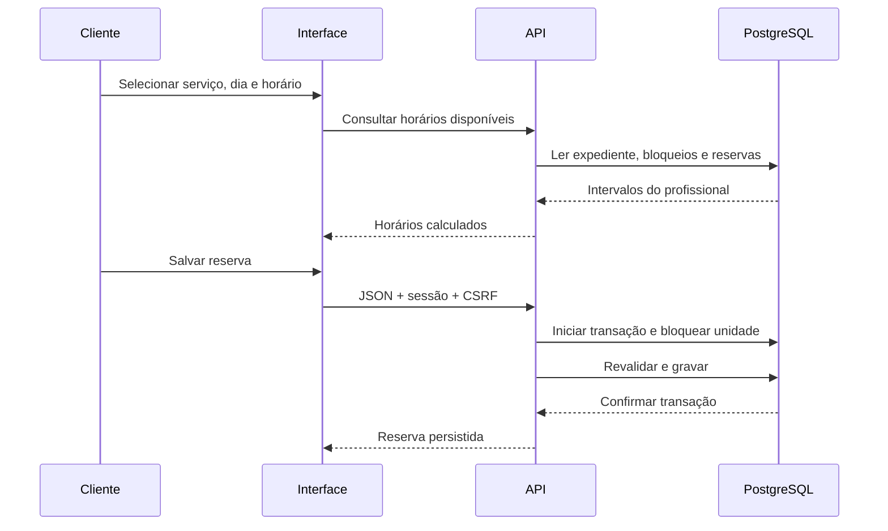

# 15. Integração Sistema × Banco de Dados

## 15.1. Percurso de uma operação

O React envia JSON por Axios. O backend autentica a sessão, valida os dados e verifica a autorização por recurso. O serviço executa a operação transacional e utiliza JPA ou JDBC parametrizado. A resposta atualiza a interface somente quando corresponde à consulta vigente.

Exemplo: ao reservar pelo portal, o servidor obtém o cliente da sessão, bloqueia a barbearia, verifica recursos e agenda, cria o vínculo ausente quando permitido e grava o atendimento com preço e término. Qualquer falha desfaz a transação.

## 15.2. Configuração de conexão

| Ambiente | Configuração |
| --- | --- |
| Execução convencional | `DB_URL`, `DB_USERNAME`, `DB_PASSWORD`; API padrão em 127.0.0.1:8080 |
| Inicializador integrado Windows | API/interface em localhost:8181, PostgreSQL local em 55441, dados em `.local/demo-dados` |
| Desenvolvimento pelos dois scripts | Vite 5173, API 8080, PostgreSQL de demonstração 55432 em `.local/postgres` |
| Render | Perfil `cloud`; `DB_HOST`, `DB_PORT`, `DB_NAME`, `DB_USERNAME`, `DB_PASSWORD`; porta interna `PORT` |

Esses bancos e endereços não são intercambiáveis. Abrir outro frontend com outra API pode mostrar dados ou contas diferentes. O inicializador integrado é o caminho recomendado para apresentar localmente.

## 15.3. Migrações e esquema hospedado

Flyway aplica somente versões pendentes; Hibernate valida a estrutura. Bases com V2/V5 aplicadas mantêm ambas as pastas de migração configuradas para validar seu histórico. Habilitar essa localização em um esquema já migrado não significa repetir o povoamento.

A demonstração hospedada usa o esquema `barberflow_apresentacao_20261118`. O Hikari e o Flyway foram configurados para esse mesmo esquema; o esquema anterior foi preservado. São usados `SPRING_DATASOURCE_HIKARI_SCHEMA`, `SPRING_FLYWAY_DEFAULT_SCHEMA` e `SPRING_FLYWAY_LOCATIONS` na configuração do serviço.

O perfil cloud mantém `barberflow.demo-acessos=false`. As contas locais foram transferidas mediante autorização, junto com os hashes e as permissões; não dependem da recriação das contas a cada inicialização.

## 15.4. Sessão e credenciais

A sessão utiliza cookie JSESSIONID, HttpOnly, SameSite=Lax e expiração por 30 minutos de inatividade; na nuvem o cookie também é Secure. Após login o identificador de sessão e o token CSRF são renovados. Mutações usam o token retornado por `/api/auth/csrf`, inclusive o logout.

Senhas são armazenadas com BCrypt de custo 12. O frontend não guarda senha ou token de sessão no localStorage; ali ficam preferências de interface. Não há fluxo de recuperação de senha por e-mail nesta versão.

Credenciais do banco e backups permanecem fora do repositório. O PostgreSQL do Render está com acesso externo bloqueado; a aplicação utiliza a conexão interna.

## Execução e publicação

### Execução local integrada no Windows

Na cópia atualizada do repositório, abrir `INICIAR-BARBERFLOW.cmd`. O inicializador prepara o pacote quando necessário, inicia a aplicação e o PostgreSQL, confere os quatro perfis e abre `http://localhost:8181/`. Usar `ENCERRAR-BARBERFLOW.cmd` para finalizar com segurança, preservando os dados.

Na primeira preparação são necessários Java/JDK 21, Node 22.12+ ou 24 e conexão para dependências. Depois de preparado, o pacote inicia sem baixar dependências; Java 21 continua necessário. Manter a janela do iniciador aberta durante a utilização.

O banco integrado fica em `.local/demo-dados`, porta 55441, e o pacote em `.local/demo-runtime`. Não apagar nem versionar `.local`. Após alterar fontes, encerrar e iniciar novamente: o inicializador detecta a mudança e recompila. Uma execução antiga ainda aberta pode continuar servindo a versão anterior.

O endereço não depende de uma porta alternativa do Vite, como 5175. Para desenvolver com recarga automática, existem `scripts/backend-local.ps1` e `scripts/frontend-local.ps1`: API 8080, Vite 5173 e banco separado 55432. Não misturar contas, dados ou endereços dessas execuções.

### Arquitetura no Render

O [serviço hospedado](https://barberflow-demo-x7py.onrender.com/) executa uma imagem Docker com frontend compilado e API Spring Boot. O PostgreSQL é um serviço separado, acessado pela rede interna. Arquivos no disco temporário do serviço web não substituem o banco.

O Dockerfile compila o React, empacota o backend e executa o JAR como usuário sem privilégios. O perfil cloud escuta em `PORT` e utiliza cookies seguros. `render.yaml` descreve os recursos Free, o teste de saúde `/api/auth/csrf` e a publicação automática desativada (`autoDeployTrigger: off`).

O blueprint descreve a criação da infraestrutura, mas **não transfere sozinho os registros locais** nem reproduz todas as configurações aplicadas posteriormente no painel.

### Estado publicado de referência

Em 18/11/2026 a versão `4571090cb233b55c7c1ffd8e3ab07434e902371a`, merge da PR #11, foi publicada no deploy `dep-dbv33ul6e07s73ajaeug`. Isso registra um estado verificável; futuras versões devem atualizar essa referência.

A transferência inicial copiou dados, contas, permissões, horários e histórico de migrações para `barberflow_apresentacao_20261118`, mantendo o esquema anterior preservado. Hikari e Flyway apontam para esse mesmo esquema e as localizações incluem migrações normais e demo para validar o histórico já importado.

O bootstrap de contas demo continua desativado. `TZ=America/Sao_Paulo` e a opção de fuso da JVM alinham a interpretação dos horários locais. Configurações e senhas do banco permanecem no ambiente do serviço, fora do código público.

### Atualizações, persistência e cópias

Uma mudança de código deve ser validada, incorporada à branch principal e publicada manualmente no serviço existente. O merge por si só não atualiza o Render nesta configuração. A atualização reutiliza o PostgreSQL e não deve executar importação ou povoamento novamente.

Antes de alterações de dados/estrutura, guardar backup recuperável. Para transportar uma base, conferir origem/destino, versões, tabelas, sequências e contas, restaurar em esquema separado e validar antes de trocar a aplicação. A publicação inicial seguiu esse procedimento e testou restauração do backup anterior.

O reinício efetivo do serviço confirmou que cadastro e reserva persistiam no PostgreSQL. Na atualização da PR #11, os registros originais e uma nova reserva de uso foram preservados. Os bancos local e remoto passam a evoluir separadamente; mudanças feitas em um não aparecem automaticamente no outro.

O banco hospedado permanece com acesso externo bloqueado. A regra temporária usada na transferência foi removida. Futuras aberturas de acesso, importações e substituições de base exigem decisão específica do responsável; não fazem parte de uma atualização comum de código.

### Condições do plano gratuito

O painel consultado na publicação indicou expiração deste banco em **17/12/2026**. Reinícios e atualizações da aplicação não renovam esse prazo. É necessário decidir e executar a preservação/migração dos dados antes da expiração; nenhum upgrade foi contratado.

Serviços web Free podem suspender após inatividade e demorar aproximadamente um minuto ou mais para voltar. Também estão sujeitos às cotas de uso do provedor. O PostgreSQL gratuito possui ciclo de vida limitado; o teste de persistência após reinício não garante retenção após sua expiração. Consulte as [condições oficiais do Render](https://render.com/docs/free).

O limite de membros do workspace refere-se aos colaboradores que administram o Render, não ao número de pessoas que fazem login na aplicação. A capacidade de atendimento ainda depende dos recursos e limites do plano.
