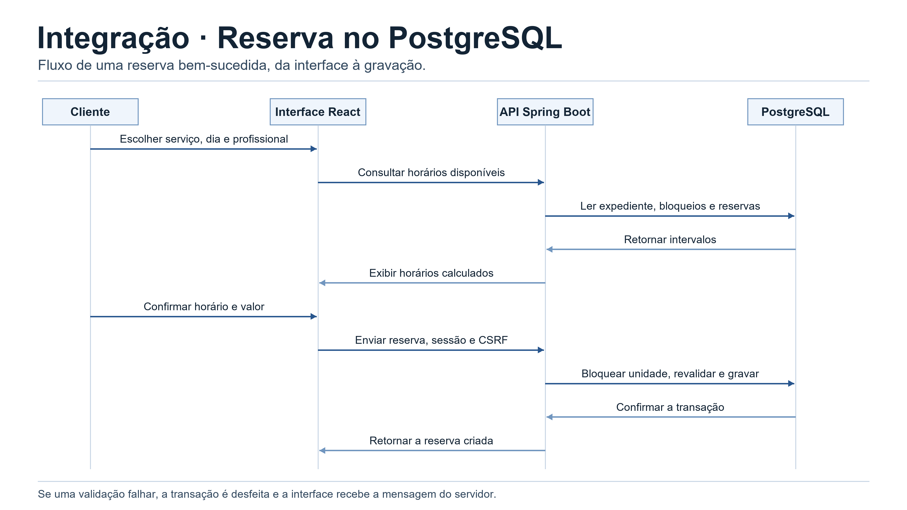

# 15. Integração Sistema × Banco de Dados

## 15.1. Percurso de uma operação

O React envia JSON por Axios. O backend autentica a sessão, valida os dados e verifica a autorização por recurso. O serviço executa a operação transacional e utiliza JPA ou JDBC parametrizado. A resposta atualiza a interface somente quando corresponde à consulta vigente.

Exemplo: ao reservar pelo portal, o servidor obtém o cliente da sessão, bloqueia a barbearia, verifica recursos e agenda, cria o vínculo ausente quando permitido e grava o atendimento com preço e término. Qualquer falha desfaz a transação.

## 15.2. Configuração de conexão

| Ambiente | Configuração |
| --- | --- |
| Execução convencional | `DB_URL`, `DB_USERNAME`, `DB_PASSWORD`; API padrão em 127.0.0.1:8080 |
| Inicializador integrado Windows | API/interface em localhost:8181, PostgreSQL local em 55441, dados em `.local/demo-dados` |
| Desenvolvimento pelos dois scripts | Vite 5173, API 8080, PostgreSQL de demonstração 55432 em `.local/postgres` |
| Vercel com Neon | Perfis `cloud,vercel`, conexão JDBC com TLS e credenciais sensíveis da integração Neon |

Esses bancos e endereços não são intercambiáveis. Abrir outro frontend com outra API pode mostrar dados ou contas diferentes. O inicializador integrado é o caminho recomendado para apresentar localmente.

## 15.3. Migrações e esquema hospedado

Flyway aplica somente versões pendentes; Hibernate valida a estrutura. Bases com V2/V5 aplicadas mantêm ambas as pastas de migração configuradas para validar seu histórico. Habilitar essa localização em um esquema já migrado não significa repetir o povoamento.

A demonstração hospedada usa o esquema `barberflow_apresentacao_20261118`. O Hikari e o Flyway foram configurados para esse mesmo esquema. São usados `SPRING_DATASOURCE_HIKARI_SCHEMA`, `SPRING_FLYWAY_DEFAULT_SCHEMA` e `SPRING_FLYWAY_LOCATIONS` na configuração do serviço.

O perfil cloud mantém `barberflow.demo-acessos=false`. A migração preservou as contas da demonstração, os hashes de senha e as permissões. A aplicação carrega esses acessos da base restaurada.

## 15.4. Sessão e credenciais

A sessão utiliza cookie JSESSIONID, HttpOnly, SameSite=Lax e expiração por 30 minutos de inatividade; na nuvem o cookie também é Secure. Após login o identificador de sessão e o token CSRF são renovados. Mutações usam o token retornado por `/api/auth/csrf`, inclusive o logout.

Na hospedagem, o Spring Session guarda as sessões em duas tabelas técnicas do PostgreSQL criadas pela migração V9. Uma instância pode continuar uma sessão iniciada por outra e o logout encerra o acesso nas duas.

Senhas são armazenadas com BCrypt de custo 12. O frontend não guarda senha ou token de sessão no localStorage; ali ficam preferências de interface. Não há fluxo de recuperação de senha por e-mail nesta versão.

Credenciais do banco e backups permanecem fora do repositório. O Vercel injeta as credenciais do Neon no ambiente de produção. O perfil `vercel` usa `PGHOST_UNPOOLED`, `PGDATABASE`, `PGUSER` e `PGPASSWORD` e verifica o certificado do servidor PostgreSQL.

## Execução e publicação

### Execução local integrada no Windows

Na cópia atualizada do repositório, abrir `INICIAR-BARBERFLOW.cmd`. O inicializador prepara o pacote quando necessário, inicia a aplicação e o PostgreSQL, confere os quatro perfis e abre `http://localhost:8181/`. Usar `ENCERRAR-BARBERFLOW.cmd` para finalizar com segurança, preservando os dados.

Na primeira preparação são necessários Java/JDK 21, Node 22.12+ ou 24 e conexão para dependências. Depois de preparado, o pacote inicia sem baixar dependências; Java 21 continua necessário. Manter a janela do iniciador aberta durante a utilização.

O banco integrado fica em `.local/demo-dados`, porta 55441, e o pacote em `.local/demo-runtime`. Não apagar nem versionar `.local`. Após alterar fontes, encerrar e iniciar novamente: o inicializador detecta a mudança e recompila. Uma execução antiga ainda aberta pode continuar servindo a versão anterior.

O endereço não depende de uma porta alternativa do Vite, como 5175. Para desenvolver com recarga automática, existem `scripts/backend-local.ps1` e `scripts/frontend-local.ps1`: API 8080, Vite 5173 e banco separado 55432. Não misturar contas, dados ou endereços dessas execuções.

### Arquitetura no Vercel

O [BarberFlow hospedado](https://barberflow-ebon.vercel.app/) executa uma imagem Docker com frontend React compilado e API Spring Boot. O Neon Free fornece o PostgreSQL em São Paulo. O Dockerfile compila a interface, empacota o backend e executa o JAR como usuário sem privilégios. O `vercel.json` identifica o projeto como contêiner.

### Estado publicado de referência

A publicação de 23/11/2026 foi validada com o código da [PR #20](https://github.com/cauamonteiro-dev/BarberFlow/pull/20). A cópia do Render foi restaurada no Neon e conferida por conteúdo em 14 tabelas e por estado em 12 sequências, antes de o Flyway aplicar V9. O teste online confirmou os quatro perfis com os acessos já existentes. O serviço web anterior no Render foi suspenso após a conferência da [prévia na MostraPlus](https://mostraplus.com.br/projects/54f3414d-d744-4ba2-a0ed-1ff36a50dedd).

### Atualizações, persistência e cópias

Validar as alterações no GitHub antes de publicar o código no projeto `barberflow` do Vercel. Em uma atualização de código, manter a integração com `barberflow-db` e o esquema da demonstração. O Flyway executa apenas as migrações pendentes.

Guardar uma cópia recuperável antes de migrar ou substituir a base. Conferir conteúdo, sequências e histórico de migrações após restaurar. A base da demonstração no Neon e o banco do inicializador local evoluem separadamente.

### Condições dos planos gratuitos

O aplicativo usa Vercel Hobby e o banco usa Neon Free. Vercel e Neon podem suspender a capacidade de processamento durante períodos sem uso. O primeiro acesso após inatividade pode levar mais tempo. Os planos estão sujeitos às cotas dos provedores. Consulte [Vercel Hobby](https://vercel.com/docs/plans/hobby) e [Neon Free](https://neon.com/docs/introduction/plans).
