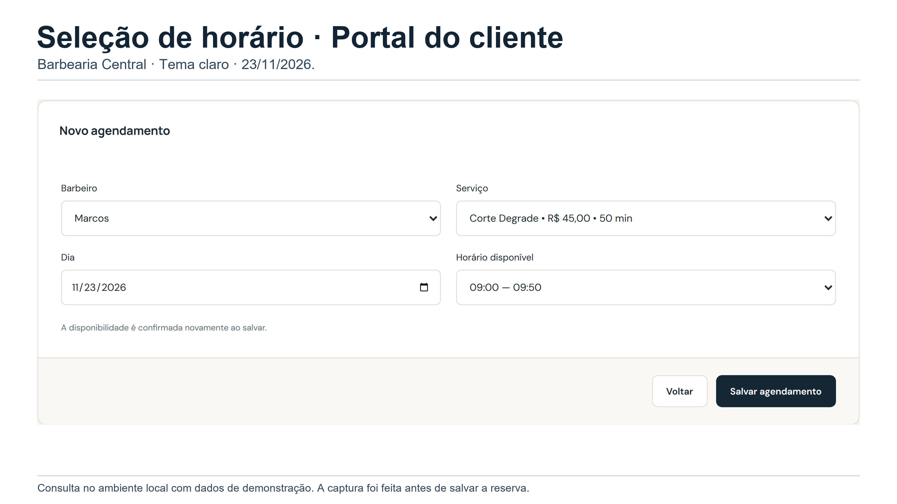

# 17. Testes

## 17.1. Estratégia

Os testes de backend executam a aplicação e as migrações com PostgreSQL real temporário, separado do banco pessoal. Testes de interface usam Playwright e um ambiente de demonstração. A imagem Docker possui uma verificação adicional com banco isolado no GitHub Actions.

| Camada | O que é verificado |
| --- | --- |
| Banco | PK, FK, CHECK, unicidade, rollback, migrações, sequências e as 15 consultas |
| Domínio/API | Cadastros, compatibilidade de unidade, estado dos recursos, assinatura e agenda concorrente |
| Acesso | Login, sessão, CSRF, perfis, autorização por ID e isolamento de cliente/unidade |
| Valores | Preço combinado, estimativas e preservação após alteração do catálogo |
| Interface | Jornadas dos perfis, reservas, pesquisa, apresentação das unidades, dashboards, CSV, temas e responsividade |
| Hospedagem | Artefatos estáticos, login, conexão com PostgreSQL e persistência após reinício |

## 17.2. Execução reproduzível

Em `backend`, executar `mvnw.cmd verify` no Windows ou `bash mvnw verify` no Linux. Em `frontend`, executar `npm ci` e `npm run build`.

Com o ambiente de teste iniciado, o script `scripts/testar-interface.ps1` prepara o navegador e executa a suíte. Para o inicializador integrado, definir `E2E_URL=http://127.0.0.1:8181`. Os testes completos de interface criam dados identificados como teste; devem ser executados em demonstração/CI, não indiscriminadamente no banco hospedado em uso.

Relatórios são gravados em `backend/target/surefire-reports/`, `frontend/test-results/` e `.local/qa/`, conforme o teste. O workflow `validacao.yml` reproduz o ambiente; `cloud.yml` valida a imagem e seus acessos.

## 17.3. Resultados da versão de referência

As verificações completas da [PR #11](https://github.com/cauamonteiro-dev/BarberFlow/pull/11) passaram no GitHub em 18/11/2026: **51 testes de API e 28 testes de interface**, além da imagem de nuvem. Os resultados estão no [workflow da revisão](https://github.com/cauamonteiro-dev/BarberFlow/actions/runs/44418891789). Na execução local da correção de horários passaram os 20 testes de `AcessoApiTest`, dois cenários específicos da interface e o build Vite.

Os novos cenários comparam a lista diária com a disponibilidade individual, cobrindo pausa, bloqueio, reserva, cancelamento e remarcação. A interface verifica consulta lenta e falha seguida de nova tentativa, sem permitir salvar um horário inexistente na resposta atual.

## 17.4. Evidência da publicação

### Registro da publicação anterior

Na publicação inicial foram conferidos 600 registros de negócio, 18 logins, conteúdo e sequências de 13 tabelas e dashboards das 15 unidades. Um ciclo de cadastro, reserva, remarcação e cancelamento foi conferido novamente após reiniciar efetivamente o serviço; os dados persistiram. Registros exclusivos desse teste foram retirados após a conferência e o conteúdo original foi comparado novamente.

Na atualização dos horários, os 600 registros originais permaneceram preservados. Uma nova reserva criada durante o uso público foi mantida. A consulta de Marcos/Corte Degrade para 20/11 retornou os mesmos 93 horários; uma medição pontual passou de cerca de 2,01 s para 0,244 s, sem constituir garantia de desempenho.

Pela interface hospedada foi selecionado 20/11/2026 às 10h, habilitando salvar. Essa verificação visual não criou uma reserva de teste adicional.

[Captura do teste de seleção de horário no Render](.gitbook/assets/horario-cliente-render-corrigido.jpg)

A imagem abaixo mostra a seleção de horário no tema claro, com dados de demonstração no ambiente local.

### Verificação após migrar para o Vercel

Na [PR #20](https://github.com/cauamonteiro-dev/BarberFlow/pull/20), passaram 56 testes de API, incluindo login, renovação de sessão e logout entre duas instâncias. A restauração no Neon igualou o conteúdo de 14 tabelas e o estado de 12 sequências da cópia da origem.

No [endereço público](https://barberflow-ebon.vercel.app/), foram conferidos o carregamento da interface, os quatro perfis de acesso, o isolamento da barbearia e do barbeiro e a consulta das reservas, assinatura e horários do cliente. A comparação entre as duas hospedagens retornou conteúdo igual em 137 conjuntos de dados, incluindo os relatórios das 15 unidades.

As evidências registram cenários e versão, sem prometer ausência de defeitos em todas as condições. Teste de carga, auditoria independente e certificação integral de acessibilidade não foram realizados.
